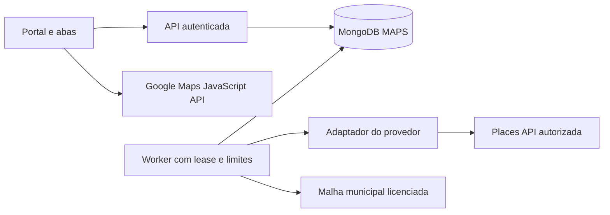

# Arquitetura e estrategia de busca

## Decisao proposta

Diretriz obrigatoria: Clean Code, Arquitetura Limpa, SOLID e orientacao a objetos.
Responsabilidades, direcao das dependencias e estrutura implementada estao em
[Estrutura e padroes](06-estrutura-e-padroes.md).

Estado atual: portal Next.js com App Router, React e TypeScript
estrito, autenticacao Google OAuth e persistencia MongoDB transacional.
Frontend e endpoints
compartilham projeto/deploy, separados por camadas. Deploy exclusivo na Vercel,
com MongoDB Atlas externo autenticado e suporte a transacoes. A API atual usa comandos
e agregado por workspace, nao o modelo normalizado de coleta abaixo.
Fonte, limites, mapa cartografico e worker externo continuam pendentes. Consulte
[Deploy na Vercel](07-deploy-vercel.md).

Para a primeira integracao, foi escolhido Google Places Text Search sob
demanda, em lista e sem mapa pago. Nao executa o plano territorial descrito
abaixo e nao persiste conteudo de provedor. Chave, revisao de politicas e
parcela da franquia compartilhada exigem configuracao explicita.
Veja [Google Places](09-google-places.md). As secoes de grade/worker a seguir
continuam sendo um alvo separado, condicionado a autorizacao especifica.

Stack do portal implementada: Next.js, React e TypeScript, com App Router
para paginas TSX e endpoints de servidor. Casos de uso nao dependem do framework.
Na Vercel, as rotas web executam no runtime da plataforma; coleta longa nao
executa dentro de funcoes HTTP.

Stack proposta para as proximas etapas: API de negocio em Route Handlers Next,
autenticacao, worker Node.js externo, MongoDB Atlas e fila persistente no MVP.
Google Maps JavaScript API para o mapa quando a fonte Google estiver habilitada;
Places API (New) no backend para descoberta.

O worker deve sobreviver ao encerramento de uma requisicao HTTP. Nao executar coleta longa dentro de uma rota web ou depender de uma aba aberta. Adotar driver oficial MongoDB e biblioteca geoespacial consolidada, como Turf, para intersecoes e testes de pertencimento.

O contrato do adaptador deve permitir trocar de fonte caso o Google nao autorize a coleta sistematica ou a retencao pretendida. Nenhum adaptador pode ser habilitado sem politica de coleta, exibicao e retencao aprovada.

## Cobertura municipal

Hipotese de projeto: dividir um municipio em unidades menores pode ampliar a descoberta em relacao a uma unica consulta central. Isso nao prova completude e depende de permissao contratual. Antes da integracao, validar essa hipotese em um piloto autorizado, comparando consulta unica e plano territorial com o mesmo teto de custo.

1. Resolver municipio em catalogo oficial, como IBGE, usando codigo municipal, UF e pais. Para o exemplo: Belem/PA, codigo IBGE `1501402`; confirmar os metadados na importacao.
2. Importar limite municipal Polygon/MultiPolygon de fonte autorizada, com versao, data, licenca e atribuicao. Nao usar apenas o retangulo ou centro devolvido por um geocodificador.
3. Gerar grade retangular que intersecte todas as partes do municipio. Parametros iniciais propostos para piloto: celulas de aproximadamente 2 km, minimo de 250 m e profundidade maxima de 3 subdivisoes; sao configuracoes de produto, nao limites oficiais da API.
4. Para cada celula, consultar o termo com restricao retangular, idioma `pt-BR` e regiao `BR`, conforme suporte da fonte. Nao combinar `locationBias` com `locationRestriction`.
5. Consumir a paginacao disponivel mantendo os parametros exigidos pelo provedor. Persistir cada pagina de maneira idempotente antes de confirmar seu checkpoint.
6. Filtrar pontos pelo poligono municipal, incluindo a borda. Pontos de municipios vizinhos sao descartados do conjunto; casos sem coordenadas ficam pendentes de verificacao territorial e fora do mapa.
7. Se houver indicio de truncamento, propor subdivisao adaptativa ate o limite autorizado. Apenas atingir o tamanho de pagina nao comprova saturacao. Respeitar teto global de celulas, requisicoes, profundidade e custo.
8. Deduplicar por Place ID e associar o estabelecimento a busca e a execucao.
9. Encerrar com relatorio de celulas, falhas, truncamentos potenciais, resultados unicos e custo estimado. Nunca anunciar "100% das lojas".

Variacoes como `aparelhos auditivos` e `loja de aparelho auditivo` sao opcionais, aprovadas pelo usuario e contabilizadas no orcamento. Nao ampliar automaticamente para conceitos como otorrinolaringologia ou fonoaudiologia.

O Text Search (New), na documentacao consultada, limita cada pagina a 20 resultados e informa no maximo 60 por consulta entre todas as paginas, sujeito a mudancas. Portanto, uma consulta unica nao corresponde a um inventario municipal. Mesmo subdivisoes podem retornar resultados incompletos ou inconsistentes.

## Estados e retomada

Execucao: `queued -> running -> completed | partial | failed | cancelled`. Pode passar de `running` para `paused` por limite/cota; retomar leva a `queued`. `partial` indica termino com lacunas conhecidas. `completed` significa plano executado sem falhas pendentes, nao cobertura integral dos estabelecimentos.

Unidade territorial: `queued`, `running`, `completed`, `failed`, `cancelled` ou `superseded` quando substituida por filhos. Progresso usa apenas folhas ativas; atualizar denominador quando houver subdivisao. Relatar folhas concluidas, pendentes e com falha separadamente.

- Reservar trabalho atomicamente com `leaseOwner`, `leaseExpiresAt` e heartbeat; recuperar lease vencido apos queda.
- Persistir plano, versao do algoritmo, termo, variacoes, cursor/pagina e tentativas.
- Transacao MongoDB deve confirmar resultados, vinculos e checkpoint da pagina juntos. Uma chamada externa nao faz parte dessa transacao.
- Se token de pagina expirar, reiniciar a unidade e deduplicar. Repeticao pode gerar cobranca mesmo sem duplicar dados.
- Aplicar backoff exponencial com jitter e numero maximo de tentativas para timeout, 429 e falhas transitorias; respeitar `Retry-After` quando fornecido.
- Erro de autenticacao ou configuracao interrompe novas chamadas; falhas de validacao nao entram em repeticao infinita.
- Cancelar impede novas unidades/chamadas; chamadas em voo podem terminar e ser cobradas. Preservar dados ja salvos.

## Custos e limites

Exigir limite de requisicoes e teto monetario estimado por execucao. Reservar atomicamente capacidade antes de cada chamada, inclusive paginacao, detalhes e repeticoes, evitando ultrapassagem por workers concorrentes. Custo real pode diferir por tabela vigente, impostos e chamadas em voo; alertas de faturamento do Google nao sao um bloqueio automatico.

Usar FieldMask explicita, sem `*` em producao. ID, nome, endereco e localizacao compoem a selecao inicial quando autorizada; telefone, site e avaliacoes so entram mediante necessidade, permissao e confirmacao do SKU correspondente. Nem todo campo esta disponivel no plano basico de cobranca.

Estimativa: soma das chamadas previstas por metodo e SKU multiplicadas pelos precos vigentes, incluindo mapa. Apresentar faixa estimada para refinamento e retries. Nao fixar promessa de gratuidade nem preco por cidade.

## Leitura sem nova coleta

Rotas GET consultam exclusivamente MongoDB. O mapa recebe coordenadas locais validas; pan, zoom, filtros e detalhes nao chamam Places. Carregar o mapa base pode acessar Google e gerar custo proprio.

Campos expirados ou nao autorizados sao omitidos pela API mesmo antes da limpeza fisica. Exibir os dados internos e IDs preservados; oferecer atualizacao explicita ou fonte licenciada. Nao executar atualizacao silenciosa em uma leitura. Sem coordenadas validas, o registro permanece na lista mas nao recebe marcador.

## Metas tecnicas iniciais

- Testar consulta local com 10 mil estabelecimentos e 5 usuarios simultaneos; meta p95 menor que 2 segundos para pagina de 50 itens em ambiente de homologacao definido.
- Atualizar progresso em ate 5 segundos por polling local ou SSE; nao consultar o provedor para calcular progresso.
- Limitar respostas de mapa, usar clusters e consultas por viewport. Pagina da tabela e conjunto geografico sao endpoints distintos.
- Logs estruturados com `workspaceId`, `searchId`, `runId` e `cellId`, sem payloads pessoais, tokens ou credenciais.